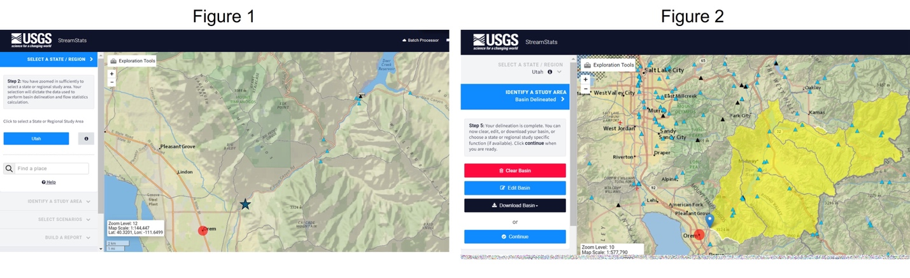
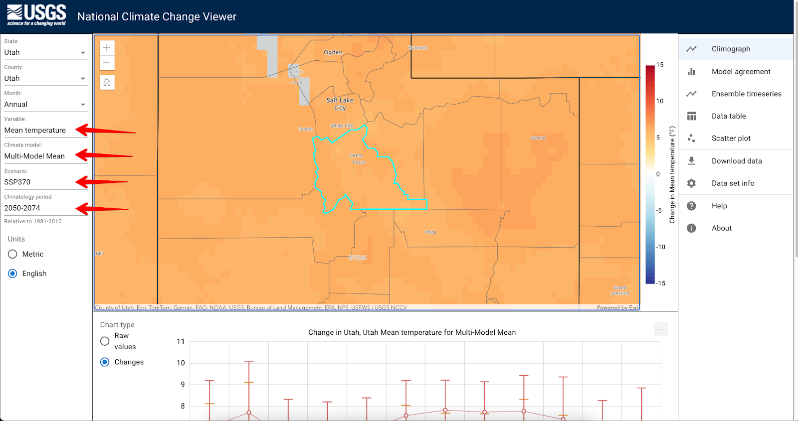
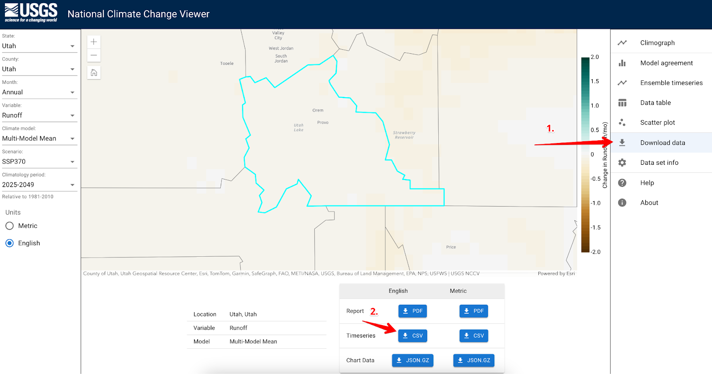

# Part 5 - Future Scenario Simulations

## Introduction

In this lab you will simulate some simple scenarios about changes in water availability based on information from StreamStats, the USGS National Water Census, and the USGS NCCV. We will pretend all the surface water from Provo Canyon is available to be used to satisfy the demand for Provo and Orem.

This lab needs to be completed using the provided template: [simulations_workbook_20260327_blank.xlsx](simulations_workbook_20260327_blank.xlsx).

## Data Files

| File | Description |
|:-----|:------------|
| [simulations_workbook_20260327_blank.xlsx](simulations_workbook_20260327_blank.xlsx) | Template workbook for this lab |
| [160202030505.csv](160202030505.csv) | USGS National Water Census monthly public supply withdrawals (MGD, surface and ground water), HUC12 160202030505 (Provo), 2000-2020 |
| [160202010804.csv](160202010804.csv) | Same, HUC12 160202010804 (Orem) |

The two HUC12 files are the Provo and Orem columns already extracted from `PS_HUC12_Tot_2000_2020.csv` (the full file is about 286 MB). You may use them instead of downloading and filtering the full file.

## Instructions

### Simulation Set 1

1. Estimate the total demand using city WCP documents and population estimates. Convert from GPCD to total MGD for these populations.
    1. The GPCD numbers from the WCP documents are averaged over the whole year. Demand is not uniform across the whole year. Demand is highest in summer and lowest in the winter.
2. Find the patterns in demand throughout the year using the USGS Water Census data [https://doi.org/10.5066/P9FUL880](https://doi.org/10.5066/P9FUL880){target='blank'}.
    1. Download the csv for total demand by HUC12, "PS_HUC12_Tot_2000_2020.csv". There is a column for year, month, and 1 for each HUC12 unit contained in the report.
    2. Find the total withdrawal for Provo and Orem. These numbers are reported by HUC12. One available for Provo is 160202030505. One available for Orem is 160202010804. You can delete the other columns to make the file size smaller. Scripting is useful to filter the unnecessary columns.
    3. Identify the peak demand month. What percent larger than average demand is the peak demand?
    4. Identify the minimum demand month. What percent smaller than average demand is the minimum demand?
    5. For simplicity in your spreadsheet, you may assume demand grows and reduces linearly between these months.
3. Use StreamStats to obtain monthly flow duration values using the steps below.
    1. Navigate to Orem, Utah. Zoom in to the area marked with a star (see Figure 1), which is on the Provo River at the mouth of Deer Creek Canyon.
    2. Click the blue box to select "Utah" as the state.
    3. Zoom in further at the starred location until thick blue streamlines appear.
    4. Click "Delineate" and then select your point of interest (the approximate star location).
    5. Click Continue, and then select Annual Flow Statistics, January Flow-Duration Statistics, ..., December Flow-Duration Statistics. Then click Continue again.
    6. Enter the monthly flow duration values and annual average flow value into the spreadsheet. Use the area-averaged values.

    

    _Figures 1 and 2. StreamStats delineation point on the Provo River (Figure 1) and the delineated basin (Figure 2)._

4. Compute the difference in supply vs demand on a monthly basis and the annual average flow basis.
5. Go to the bottom table so you can make a few edits to alter the scenario.
    1. Assume supply does not change and you are considering the 50% EP case.
    2. Assume changes in demand are uniform on each month. If demand increases by 1% overall, assume it increases by 1% in each month.
    3. Determine how much the demand can increase (as %) until the 50% EP supply is no longer adequate.

### Simulation Set 2

Use the USGS National Climate Change Viewer ([https://www.usgs.gov/tools/national-climate-change-viewer-nccv](https://www.usgs.gov/tools/national-climate-change-viewer-nccv){target='blank'}).

1. Select your state and county. You can either use the drop down menus or click on the map to find your content.
    1. Choose "Annual" as the kind of series.
    2. Select the Variable you are interested in. For this exercise, choose "Runoff".
    3. Choose the climate model and the future scenario (RCP and SSP). Use "Multi-Model Mean" and "SSP370" to begin.
    4. Use the period 2050-2075 but you may be interested in seeing the changes in other periods as well.

    

    _Figure 3. NCCV settings (the example shows Mean temperature; choose Runoff)._

2. On the bottom middle of the screen, change the plot type to "Changes" so that it shows relative differences compared to the normal. Note that there are 3 lines labeled SSP245, SSP370, SSP585. These are the modeling scenarios used to generate the predictions (1 RCP and 1 SSP combination each). The solid black line is the normal value for each month.
    1. Choose "Download data" from the right center of the screen. Then click on the CSV button under the column labeled English and the row labeled Timeseries.

    

    _Figure 4. Downloading the NCCV timeseries CSV._

## Deliverables

Complete the workbook and answer the questions about your numbers.
