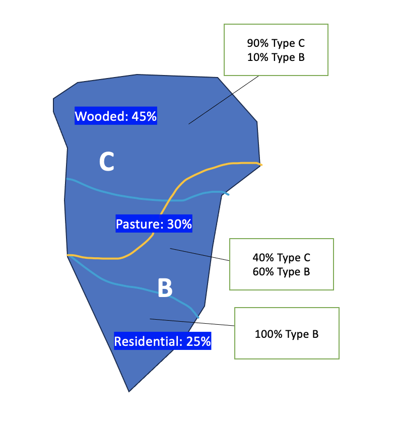

# In-Class - Synthetic Unit Hydrographs

We will work these examples together in class. Each one is the same type of problem as a homework problem, with different numbers.

Excel starter file: [Synthetic Unit Hydrographs Example Template.xlsx](Synthetic%20Unit%20Hydrographs%20Example%20Template.xlsx)

Textbook Examples 2-6 (SCS UH) and 2-7 (convolution) spreadsheet: [Example2-6and2-7.xlsx](Example2-6and2-7.xlsx)

# Example A - Composite CN and Runoff from a 5-in. Storm

A 320-ac drainage area in Spanish Fork has the following land cover:

- 45% wooded (good condition)
- 25% residential, 1/4-acre lots
- 30% pasture (good condition)

Soil types B and C are distributed across the three land use types according to the diagram: wooded is 90% Type C and 10% Type B; pasture is 40% Type C and 60% Type B; residential is 100% Type B. A design storm delivers P = 5 in.

a. Build the CN cross-table and compute the composite CN. 
b. Compute S and $I_a$; check that $P \ge I_a$. 
c. Find Q (in.) from Eq. 2-22 and the runoff volume in ac-ft.

Find: composite CN, S, $I_a$, direct runoff Q (in.), and total runoff volume (ac-ft).

# Example B - SCS Triangular UH, Pre- vs. Post-Development

A small watershed in Provo Canyon drains 5 mi² to a county-road culvert. The main channel is L = 4 mi (21,120 ft) long with an average slope of 80 ft/mi (y = 1.515%). A 2-hr design storm is used.

- Pre-development: the basin is rangeland (composite CN = 60).
- Post-development: a new subdivision and access roads raise the composite CN to 80.

Using the SCS triangular UH method, find $t_p$, $T_R$, $Q_p$, B, and the time base for both conditions and compare.

$$S = \frac{1000}{CN} - 10 \qquad t_p = \frac{L^{0.8}(S+1)^{0.7}}{1900\sqrt{y}} \qquad T_R = \frac{D}{2} + t_p \qquad Q_p = \frac{484A}{T_R}$$

with B found from the condition that the UH volume equals 1.0 in.

# Example C - Is It a Unit Hydrograph?

A consulting firm hands you a direct-runoff hydrograph for a 600-ac watershed:

- triangular shape
- $Q_p$ = 200 cfs
- rise time = 2 hr
- fall time = 4 hr
- baseflow = 0

They claim it is the 1-hr unit hydrograph for the basin. Verify their claim by computing the depth of direct runoff under the hydrograph and comparing to 1.0 in.

Find: the direct runoff volume under the triangle (cfs-hr and ac-in), the runoff depth over the watershed (in.), and whether it is a UH.

# Example D - Unit Hydrograph Derivation (More Synthetic Unit Hydrographs)

Separate baseflow, find the volume and depth and derive the 1-hr UH.

Given: area A = 5 mi², baseflow = 80 cfs, and the observed hydrograph:

| t (hr) | Q observed (cfs) |
|:---:|:---:|
| 0 | 80 |
| 1 | 400 |
| 2 | 1120 |
| 3 | 1680 |
| 4 | 1360 |
| 5 | 980 |
| 6 | 720 |
| 7 | 480 |
| 8 | 260 |
| 9 | 120 |
| 10 | 80 |

Excel starter file: [CE331_UHDerivation_Problem.xlsx](CE331_UHDerivation_Problem.xlsx)
